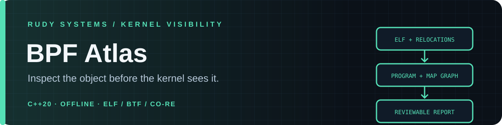

<p align="center"></p>

<p align="center">
  <a href="https://github.com/r4venrudy/rudy-bpf-atlas/actions/workflows/ci.yml"></a>
  
  
  <a href="LICENSE"></a>
</p>

<p align="center"><strong>Inspect the object before the kernel sees it.</strong><br>Offline structural review for eBPF object files, local development, and CI.</p>

<p align="center"><a href="#capabilities">Capabilities</a> · <a href="#quick-start">Quick start</a> · <a href="docs/RULES.md">Rule catalogue</a> · <a href="docs/FORMAT.md">Format contract</a> · <a href="https://rudy.systems">Rudy Systems</a></p>

---

## Why BPF Atlas

An eBPF object is a compact program plus relocations, map declarations, kernel-facing metadata, and optional CO-RE records. BPF Atlas gives reviewers a deterministic summary before deployment: which program sections exist, which helper calls and maps are visible, where control-flow edges lead, and whether basic metadata is structurally sound.

It is a **static inspection aid**, not a kernel verifier replacement. Linux's verifier evaluates programs against a target kernel and its available helpers, types, attach points, and configuration. BPF Atlas does none of that: it never calls `bpf()`, loads a program, attaches to an event, contacts a host, or executes object code.

## Capabilities

| Area | What it reports |
| --- | --- |
| ELF safety | Bounds-checked ELF64 little-endian relocatable `EM_BPF` parsing, section and symbol tables, and relocation references |
| Program inventory | Recognized libbpf section conventions, instruction-slot counts, branch counts, and program type labels |
| Call relationships | Function symbols and direct `R_BPF_64_32` local-call relocation targets |
| Call review | Known helper names, retained IDs for unknown helpers, and focused review notes for user-memory writes and return overrides |
| Map references | Map symbol names reached through ELF relocation records |
| Control flow | Out-of-range branch/local-call targets, branches into `ldimm64` continuation slots, and reported backward edges |
| Stack shape | Direct frame-pointer accesses outside the documented 512-byte BPF stack frame |
| Metadata | License string, BTF type count, and BTF.ext CO-RE relocation count with area-bound checks |
| Automation | Text, JSON, SARIF 2.1.0, severity gates, portable CMake build, and dependency-free tests |

## Quick start

Requires a C++20 compiler and CMake 3.20 or newer. The analyzer has no runtime library dependencies.

```sh
cmake -S . -B build -DCMAKE_BUILD_TYPE=Release
cmake --build build --config Release
ctest --test-dir build --output-on-failure
```

Inspect a locally built BPF object:

```sh
clang -O2 -g -target bpf -c examples/xdp_allow_all.bpf.c -o /tmp/xdp_allow_all.bpf.o
./build/rudy-bpf-atlas inspect /tmp/xdp_allow_all.bpf.o
./build/rudy-bpf-atlas inspect /tmp/xdp_allow_all.bpf.o --format sarif > bpf-atlas.sarif
./build/rudy-bpf-atlas inspect /tmp/xdp_allow_all.bpf.o --format json --fail-on warning
./build/rudy-bpf-atlas inspect /tmp/xdp_allow_all.bpf.o --max-file-size 8388608
```

The sample is deliberately minimal and is only a parser smoke test. It returns `XDP_PASS`; it does not install or attach a program. On Windows, the executable is `build/Release/rudy-bpf-atlas.exe` with the default Visual Studio generator.

## Output and exit codes

The JSON schema identifier is `https://rudy.systems/schemas/bpf-atlas/v1`. SARIF output uses version 2.1.0 and intentionally omits source line locations because an ELF instruction offset is not a source line. Use `--fail-on note|warning|error` to make findings a CI gate. The default maximum input is 256 MiB; `--max-file-size` accepts a positive byte count to lower or raise that limit.

| Code | Meaning |
| ---: | --- |
| `0` | Analysis completed without a finding at or above the requested gate |
| `1` | At least one finding met the requested severity threshold |
| `2` | Invalid arguments, unsupported input format, or malformed/truncated input |

## Scope and limits

BPF Atlas currently accepts **ELF64, little-endian, `ET_REL`, `EM_BPF`** objects. It does not disassemble source, execute instructions, resolve target-kernel BTF, perform CO-RE relocation, model map-value lifetimes, prove verifier-safe pointer arithmetic, or decide whether a loop is bounded. A backward edge is a review cue, not a verdict. Helper availability varies by kernel, program type, and configuration; the built-in helper-name catalogue is intentionally partial.

The tool is best used as one review layer alongside source review, the target kernel's verifier, `bpftool`, and deployment-specific checks. A clean report does not establish that a program is safe or loadable.

## Project documents

- [Rule catalogue](docs/RULES.md)
- [Input format and parser contract](docs/FORMAT.md)
- [Contributing](CONTRIBUTING.md)
- [Security policy](SECURITY.md)
- [Linux BPF ISA](https://docs.kernel.org/bpf/standardization/instruction-set.html)
- [BPF ELF relocations](https://docs.kernel.org/next/bpf/llvm_reloc.html)
- [BPF documentation](https://docs.kernel.org/bpf/)

## License

MIT. See [LICENSE](LICENSE).
